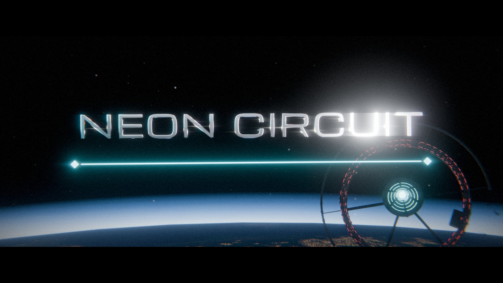

# NEON CIRCUIT

スキルとノードをつないで自動攻撃を組み立てる、SFハクスラゲームです。レンジャー・タンク・アサシンの3クラスを選び、軌道施設アークの救出作戦で全10ウェーブに挑みます。



現在の実装は、斜め見下ろしの3D戦闘画面、WebGL2を利用できない場合の2D表示、オープニング、音楽・効果音を含みます。プレイ可能な開発版として、友達と改善していくためのリポジトリです。

## 起動する

必要なものはGit、Git LFS、ブラウザです。ローカルサーバーにはPython 3を使用できます。ゲーム自体の起動にnpm installやビルドは不要です。

```bash
git lfs install
gh repo clone miki-826/NEON-CIRUCUIT
cd NEON-CIRUCUIT
git lfs pull
python -m http.server 8000 --bind 127.0.0.1
```

ブラウザで [http://127.0.0.1:8000/](http://127.0.0.1:8000/) を開いてください。GitHub CLIを使わない場合は `git clone https://github.com/miki-826/NEON-CIRUCUIT.git` でも取得できます。`index.html` を直接開く方法もありますが、共同開発では上のローカルサーバー経由で確認すると条件をそろえられます。

**動画・音源・埋め込みモデルはGit LFSで管理しています。** 「Download ZIP」ではLFSの実体が含まれない場合があるため、開発時はクローンと `git lfs pull` を使ってください。

## 遊び方

1. 開始ボタンからオープニングへ進みます。Escまたは「スキップ」で飛ばせます。
2. タイトルの「出撃する」から、クラスと3択のマスタースキルを選びます。
3. WASD・矢印キー、または戦闘エリアのドラッグで移動します。スキルは個別にコストをため、条件がそろうと自動発動します。
4. レベルアップの3択とボス報酬で強化します。Escメニューの「スキル回路」で、選択したスキルにノードを接続します。
5. 敵の橙の照準線と赤い攻撃予告円を避け、最終ウェーブのCIRCUIT-0を倒します。

Escで一時停止し、スキル回路・設定・通信ログを開けます。設定ではBGMと効果音、画質などを変更できます。進行中の出撃は保存されません。

### 主な内容

- 3クラス、17種のスキル、各スキルに最大2つのノード。
- スキルごとの充填リングと残り秒数。
- 10ウェーブ、各3ラウンド。敵部隊を全滅させると進むラッシュモードのほか、約1時間・指定時間モード。
- 3Dロボット、オープニング、節目の通信とエンディング。
- 通常戦の提供曲「Metal and Nerve」と、ボス戦用「Core Lockdown」。

時間モードや設定の詳細は [ゲームガイド](docs/GAME_GUIDE.md) を参照してください。

## 共同開発する

スキル設定をScratch風のブロックUIへ移行する提案は、[スキル回路の全体アーキテクチャとデータ構造（ステップ1）](docs/VISUAL_SKILL_ARCHITECTURE.md)を参照してください。現在は設計レビュー段階で、実装は承認後に段階的に進めます。

**mainへ直接pushせず、作業ブランチからPull Requestを作る運用にします。**

```bash
git switch main
git pull --ff-only origin main
git switch -c feat/your-name-change
```

push前の確認、Forkでの参加方法、衝突の解消、大容量素材の扱いは [CONTRIBUTING.md](CONTRIBUTING.md) にまとめています。Pull Requestを作ると確認項目のテンプレートが表示されます。保護ルールや共同編集者の招待は管理者がGitHubで設定してください。

## ファイル構成

| 場所 | 内容 |
| --- | --- |
| `index.html`、`*.css` | 画面、HUD、タイトルとメニュー |
| `game.js` | 戦闘、スキル、成長、ラウンド進行 |
| `render3d.js` | three.jsによる戦場とキャラクターの描画 |
| `effects.js` | 2Dの軌跡・着弾・攻撃予告 |
| `title.js`、`mission.js` | オープニング・タイトル操作、通信シナリオ |
| `sound.js` | 効果音とBGMの再生・設定 |
| `assets/` | 画像、フォント、音声、動画 |
| `vendor/` | 配布するthree.js、モデル、埋め込みテクスチャ |
| `tools/` | 検証、武器音・BGM・ロボットの生成スクリプト |

## 変更を検証する

構文と素材の参照チェックにはNode.js 20以降を使用します。

```bash
node tools/check.mjs
node tools/verify_combat.cjs
```

加えてブラウザで変更した機能を確認してください。静的チェックと固定条件の戦闘テストだけでは、見た目、音の好み、難易度の妥当性は判定できません。

生成ツールを使う場合だけ、Pythonの追加ライブラリをインストールします。

```bash
python -m pip install -r tools/requirements.txt
```

ロボットの再生成にはBlenderも必要です。詳しくは [ツールの使い方](tools/README.md) を参照してください。

## 素材とライセンス

three.jsのMITライセンスとフォントのOFL文書を同梱しています。提供曲や動画を含む素材の出典・利用条件は [素材一覧](docs/ASSETS.md) を確認してください。独自コードと素材に適用するプロジェクト全体のライセンスは未設定です。

## Vercelで公開

Vercelに対応しています。Git LFSの有効化が必要です。設定と公開手順は [Vercel公開ガイド](docs/VERCEL.md) を参照してください。
