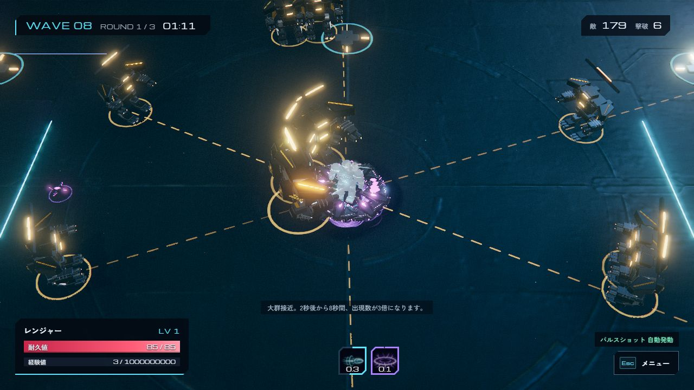

# フェーズ1：敵・ウェーブ・ラッシュ

今回の対象は難易度と敵数に伴う負荷対策のみ。ホバー、弾エフェクト刷新、格納庫メニューは未着手。

- 出撃直後は低HPの群れ型。時間・ウェーブに応じてバッチ1〜8体、出現間隔0.98秒から最短0.16秒へ変化。
- 通常の包囲出現と一方向の群れを交互に使用。WAVE3以降の群れ編成は18体以上。画面外28〜62pxに現れ、プレイヤーから160px以内になる位置は反対側へ変更。
- 群れ、重装タンク、予兆射撃、追撃型の4役割。重装は高HP・大きい当たり判定・引き寄せ耐性を持つ。
- HPと接触・射撃・ボス範囲攻撃の威力を曲線的に上昇させる。群れの経験値は2撃破で1。大量撃破でレベルが上がりすぎることを抑える。
- 25秒で初回WARNING、2秒後から8秒間は通常バッチの3倍。次回は45秒後。一時停止・選択中はゲーム時計が止まる。ボス出現にも専用警告。
- ラッシュでもラウンドの残り出現予算と上限を守り、通常敵179体＋ボス1体まで。ラッシュのデモでは敵全滅で早期進行、時間モードでは残敵を倒すまで次へ進まない。

## 速度の制約

既存の `boss:53 / elite:71 / hunter:123 / 通常:68〜92` と、既存のウェーブ係数 `1 + wave * 0.044` をそのまま維持。今回の経過時間、ラッシュ、新しいHP倍率を移動速度へ加えていない。プレイヤー速度も変更していない。スロウ等の既存スキル効果は維持する。

## 負荷対策

既存3Dモデルプールを維持し、敵のゲームデータにも再利用プールを追加。弾の命中履歴・遅延攻撃・退場描画が古い敵参照を保持するため、退役から7秒後に再利用する。弾の移動線分の周囲を80pxセルの空間索引で検索し、全敵総当たりを避ける。同時弾512上限も維持。

## 確認

```bash
node tools/verify_encounters.cjs
node tools/verify_circuit.cjs
node tools/verify_upgrade_combat.cjs
node tools/verify_combat.cjs
node tools/build-static.mjs
```

速度、倍率、編成、上限、プールの遅延再利用、ラッシュとボス進行、リセットを自動検証。既存の固定シード10ウェーブも完走。160敵・512発で120回の命中判定はローカルCPUテスト約277ms（描画なし、FPS保証ではない）。ブラウザでは無敵・固定WAVE8の一時QAシーンで179体とWARNINGを確認し、コンソールエラーなし。QA専用ファイルは公開用ビルドへ残さない。


