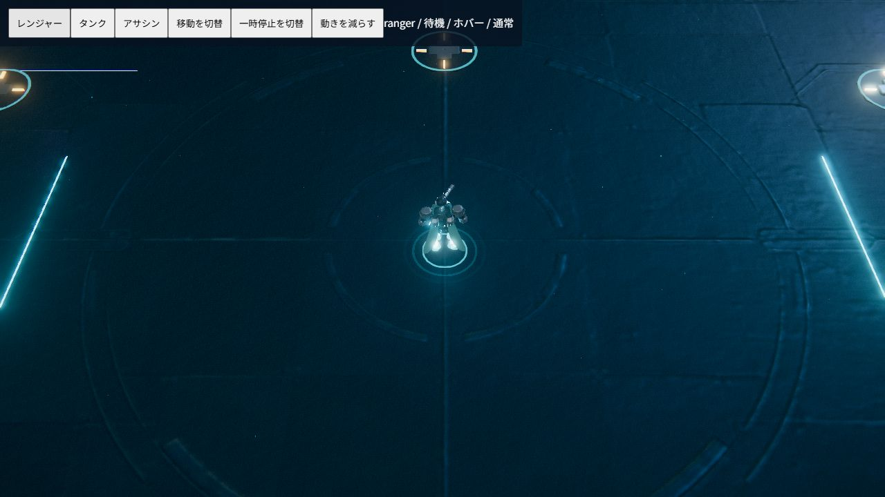

# フェーズ2：プレイヤー機の低軌道ホバー

レンジャー・タンク・アサシンの見た目をホバー移動へ変更。ゲーム座標、クラス速度、入力、衝突、スキルの移動補正には変更を加えていない。フェーズ2の変更に`game.js`は含まない。

## 描画

- 実モデルのIdle/Run/Walkはプレイヤー機では再生せず、上半身のFireだけを残す。簡易モデルの脚振りも削除し、軽く脚を畳んだ姿勢にする。
- 地面から0.58描画単位の高さへ持ち上げ、±0.045のサイン波で上下する。微細な姿勢の揺らぎも付ける。
- 実際の速度ベクトルを機体のローカル座標へ変換し、ピッチ・ロールを補間する。旋回角の差でバンクを追加。角度は±π境界を最短経路で越える。
- 両脚裏と背面の4基に発光ノズル・ネオン噴流・白いコアを常設し、移動・旋回に応じて伸ばす。
- 円い接地影と2つの風圧リングは地面側の親に置く。機体が浮いたり傾いても影とリングは地面から離れない。
- GLB読み込み時にもホバー噴射口を隠さない。GLBなしの簡易モデルでも同じ演出を使う。
- 低モーション設定では上下振動・チルト・バンク・リングの拡張アニメーションを止める。静的な浮遊高・噴射光は残す。一時停止中はホバー姿勢の時計も停止する。

`hover-motion.js`はゲーム状態へ書き込まない姿勢計算、`render3d.js`は姿勢とエフェクトの反映を担当する。フレームごとのメッシュ生成は行わず、生成したジオメトリ・マテリアルは既存のdispose経路へ登録する。公開ビルドにも新スクリプトを追加した。

## 確認

```bash
node tools/verify_hover.cjs
node tools/verify_encounters.cjs
node tools/verify_circuit.cjs
node tools/verify_upgrade_combat.cjs
node tools/verify_combat.cjs
node tools/build-static.mjs
```

凍結したゲームスナップショットに対して浮遊・傾き・旋回・停止・低モーション・30/60Hzの補間を検証。既存10ウェーブ戦闘と強化テストも成功。

ブラウザでは固定座標の検証シーンで、実モデルと簡易モデルそれぞれ3クラスの待機・移動・停止を確認。実モデルの低モーション設定も確認し、コンソールの警告・エラーなし。検証画面は描画へ190px/sの速度ベクトルを渡して姿勢だけを確認するもので、ゲームのクラス速度設定を変更していない。検証専用HTMLは最終distから除去する。



敵の演出、弾パーティクル刷新、格納庫UIは今回の対象外。フェーズ3はユーザーの確認後に進める。
