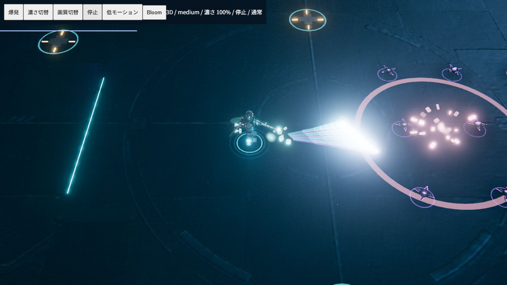

# フェーズ3：弾と着弾エフェクト

既存の`game.js`の発射・命中・撃破・爆発イベントを、3D/2D共通の視覚シミュレーションへ接続した。スキル強化後の弾速・弾数・弾径・色・爆発範囲をそのまま描画に使う。ダメージ、当たり判定、クールダウン、敵とプレイヤーの移動速度は変更しない。

## 描画

- 弾は白い細長いコア、スキル色の半透明オーラ、過去の実座標を結ぶ最大7区間の軌跡、こぼれる光粒で描く。追尾や分裂も各弾の履歴に従う。敵弾にも適用する。
- 発射位置に55msの閃光と小さい衝撃波を出す。ビーム・斬撃など、弾を作らない主スキルの発動にも発射光を接続する。
- 着弾・爆発は75msの白い閃光、急拡大するリング、減速しながら短くなる方向付き火花、上昇・拡散して残る煙を同時に生成する。火花と光粒は白〜黄色からスキル色へ変わり、減衰して消える。
- 光は加算合成、煙は通常の透明合成。3Dの光は既存Bloomへ流す。2DはCanvasの加算合成とぼかしを使う。柔らかい板状の光と煙は床との交差で四角く切れないようにする。
- 大きい爆発で微細なシェイクを追加。既存の「画面の揺れ」オフとOSの低モーション指定を尊重する。シェイクは描画時計から計算し、戦闘用の乱数を消費しない。

Esc → 設定に「エフェクトの濃さ」0〜100%を追加。弾芯・オーラ・軌跡・粒子・従来のスキル光・爆発ライト・焦げ跡へ同じ係数を掛け、localStorageへ保存する。攻撃予告、敵本体、ダメージ表示、機体のホバー噴射と背景照明は、この戦闘エフェクト設定から独立している。

## 負荷とライフサイクル

`combat-fx.js`のプールは最大1536個のレコードを先に確保する。低画質320、中画質768、高画質1536個を上限にし、満杯なら追加生成を省く。3Dでは種類別のInstancedMeshを使い、粒子ごとのメッシュ・マテリアル作成を避ける。弾の描画は従来どおり自機側・敵側各512発まで、履歴は各弾8点、3D軌跡は合計7168区間まで。

低画質では軌跡を2区間へ減らし、こぼれる粒を省く。低モーションでは軌跡を省略し、発生数・移動量・明るさを下げる。粒子の時計は一時停止・強化選択中に止まる。出撃し直す際は粒子・軌跡・焦げ跡・ライト・レベルアップの残光を消す。描画入力には書き込まず、粒子用の乱数は専用に持つ。ジオメトリとマテリアルは既存のdispose経路に登録する。

## 検証

```bash
node tools/verify_combat_fx.cjs
node tools/verify_hover.cjs
node tools/verify_circuit.cjs
node tools/verify_upgrade_combat.cjs
node tools/verify_encounters.cjs
node tools/verify_combat.cjs
node tools/build-static.mjs
```

粒子の寿命・減速・色変化、上限到達時のレコード再利用、画質切替、入力不変性、停止・再開、軌跡履歴、透明度0と中間値を自動検証。既存スキル強化と10ウェーブ戦闘も検証する。

ブラウザでは同じ描画コードを使った検証シーンで3D/2D、透明度0/25/100%、低・中・高画質、低モーション、Bloom切替、一時停止を確認。本編でも出撃・敵撃破・レベルアップ・設定変更と再読み込み後の保存値を確認し、警告・エラーなし。検証専用HTMLは公開ビルドに含めない。実機での100体以上のFPS保証を行うベンチマークではない。



格納庫メニューと出撃シークエンスはフェーズ4で扱う。
