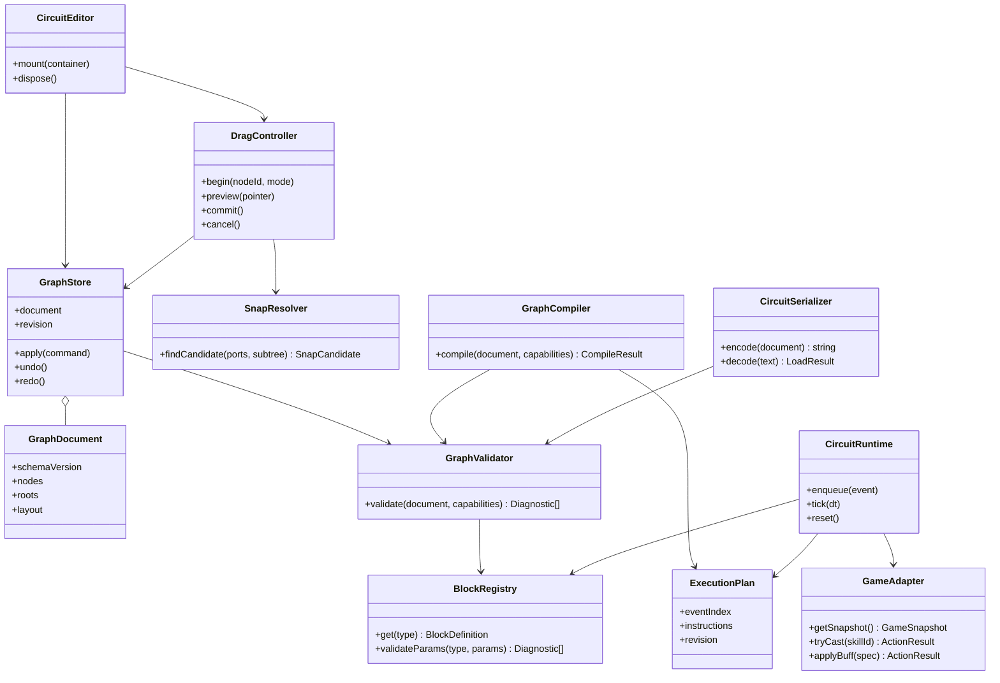

# スキル回路の全体アーキテクチャとデータ構造（ステップ1）

状態: 設計提案・レビュー待ち。ステップ2〜4の実装は承認後に進める。
調査対象: mainの`c0948de`。今回の変更は設計書とREADMEのみ。

## 1. 現状と採用方針

本ゲームはHTML/CSSと通常のJavaScriptによるブラウザゲームである。既存の起動方法を維持し、新しいフレームワークやビルド工程を必須にしない。

| 現在の場所 | 責務 | 移行方針 |
| --- | --- | --- |
| `index.html`の`#page-build`、`#skillList`、`#nodeList` | 一時停止中の回路画面 | パレット・ワークスペース・設定欄に置換 |
| `game.js`の`renderBuild()` | カード選択と最大2個の強化ノード着脱 | エディターへ段階的に委譲 |
| `masters`、`subs`、`nodes`、`builds`、`inventory` | 定義、所持品、ランク、充填 | GameAdapterから参照し、保存グラフと分離 |
| `activateSkills()`、`costOf()`、`chargeRate()`、`shoot()`、`useSub()` | 充填計算と発動 | 既存計算と発動条件を維持 |
| `hurtEnemy()` | ダメージと撃破判定 | ロジック用撃破イベントを生成 |
| `emit()`、`frameEvents` | 描画用イベント（最大64件） | ロジック用キューは別に設ける |
| `neon-settings` | 画質等の保存 | 回路は別キーで保存 |

**採用案:** 単一親・循環なしのブロックの森を、ID参照のグラフとして管理する。画面座標から実行順を推測せず、イベントを根として条件の分岐とアクションの順次処理を表す。

初期対象は「出撃時」「敵撃破時」「HP50%以下になった時」、確率・近傍敵条件、所持スキル発動、一時能力上昇。ループ、変数、数式、並列実行、ユーザーによるJavaScript入力は後続拡張とする。

## 2. 責務とクラス図

クラス名は責務の境界を示す提案。実装時には通常のオブジェクトや関数でもよい。



UIはモデルへ依存し、実行系はモデルとゲーム境界へ依存する。モデルと実行系はDOMを参照しない。ゲーム本体のIIFE内でGameAdapterを生成し、必要な関数だけを渡す。内部状態全体をwindowへ公開しない。

## 3. データ構造

### 定義とインスタンス

BlockDefinitionはレジストリ内の固定定義で、`type`、`kind`、ラベル、色、パラメーターの型・範囲・初期値、ポート、評価ハンドラーを持つ。保存時はハンドラーやラベルを含めず、安定したtypeを参照する。

BlockNodeは配置インスタンスで、`id`、`type`、`params`、`links`を持つ。kindは定義から導出する。リンクは接続先IDまたはnull。DOM・親オブジェクト・実行中の状態を保存しない。

| kind | 入力 | 出力 | 実行意味 |
| --- | --- | --- | --- |
| event | なし | `next` | 発火時に本体を開始 |
| condition | 親から1本 | `then`、`else`、`next` | 片側の分岐を実行後、共通後続へ進む |
| action | 親から1本 | `next` | アクションを試みて後続へ進む |

条件はScratch風のC字形で、内側にthen/elseのスタック、外側の下端にnextを持つ。条件の入れ子も許す。

| 初期type | params | ハンドラーの役割 |
| --- | --- | --- |
| `event.deploy` / `event.enemyDefeated` | なし | 対応イベントを購読 |
| `event.hpBelow` | `threshold: 0.5`（0〜1） | 閾値の交差を監視 |
| `event.skillReady` | `skillId` | 対象スキルの発動機会を購読 |
| `condition.chance` | `probability: 0.5`（0〜1） | 注入乱数で真偽を返す |
| `condition.enemyNearby` | `radius: 150`（初期案1〜960） | プレイヤー中心の距離判定 |
| `action.castSkill` | `skillId` | 所持・充填・射程を検証して発動 |
| `action.buff` | `stat: "attack"`、`multiplier: 1.2`、`duration: 3` | 一時補正を追加。初期案はattack/defense/speed、倍率1〜2、秒数0.1〜30 |

### JSON例（保存形式案）

これは仕様例であり、この段階ではローダーや実行コードを追加しない。

```json
{
  "schemaVersion": 1,
  "id": "circuit-demo",
  "roots": ["event-kill"],
  "nodes": {
    "event-kill": {
      "id": "event-kill",
      "type": "event.enemyDefeated",
      "params": {},
      "links": { "next": "condition-chance" }
    },
    "condition-chance": {
      "id": "condition-chance",
      "type": "condition.chance",
      "params": { "probability": 0.5 },
      "links": { "then": "action-pulse", "else": null, "next": null }
    },
    "action-pulse": {
      "id": "action-pulse",
      "type": "action.castSkill",
      "params": { "skillId": "pulse" },
      "links": { "next": null }
    }
  },
  "layout": {
    "rootPositions": { "event-kill": { "x": 80, "y": 60 } },
    "viewport": { "x": 0, "y": 0, "scale": 1 }
  }
}
```

rootsは親のない全スタックを順序付きで保持し、切り離した条件・アクションも含む。実行対象はeventを根とするスタックだけ。未接続スタックは警告表示し、保存と編集は許す。接続済みの位置は根の座標と測定サイズから導出する。親索引・ポート位置はメモリ上の派生情報とする。

### 不変条件と上限

- nodesのキーとidが一致し、全参照先が存在する。未知のtype・余分なポート・不正なparamsはエラー。
- 親は最大1つ。循環、自分への接続、ノード共有、eventへの入力接続は禁止。
- rootsは重複せず、入次数0の全ノードと一致し、全ノードを辿れること。
- 確率は0〜1、半径・秒数は定義ごとの有限範囲、スキルID・能力名は許可リストに限定。
- 初期上限案は1文書256ブロック、深さ32、入力JSON 256 KiB。共通定数で管理する。
- 構造エラーと未所持スキル等の実行資格エラーは分ける。後者はテンプレートとして保存できるが、そのまま戦闘へ適用できない。
- 編集・外部JSONに同じ検証を適用し、nodeId・項目・日本語の理由を返す。

## 4. UI管理と結合・分離

左にパレット、中央にスクロール・ズーム可能なワークスペース、右に設定欄と検証結果を置く。eventは帽子形、conditionはC字形、actionは通常形とし、色だけに依存しない。

DOM/CSSでブロックを描画し、ポートを測定する。Pointer Eventsとpointer captureでマウス・タッチ・ペンを共通処理する。境界・パン・ズームの座標変換は一箇所に集約する。

GraphStoreを唯一の確定データとする。選択・hover・ドラッグ仮位置・スナップ候補はEditorStateに分離する。移動中はプレビューだけを描き、ドロップ時に1コマンドとして確定する。既存renderBuildのinnerHTML更新で編集中DOMを毎フレーム再生成しない。

1. 根のドラッグは、条件の両分岐と後続を含む全子孫をまとめて動かす。
2. 中間ブロックの通常ドラッグは、当該ブロック以下の全子孫を親から切り離して動かす。元の親のリンクはnullとし、前後を自動接続しない。
3. 「このブロックだけ取り外す」も用意する。actionは元の親をnextへつなぎ直し、外したactionのnextをnullにする。conditionは分岐を保持して外し、外側nextだけを元の親へ戻す。eventは根移動のみ。
4. 初期実装は空きポートへの結合とする。画面上24 CSS px以内の互換ポートを候補表示し、最短距離、同距離ならID順で決定する。ズーム率によらず画面距離で判定する。
5. 移動中の子孫、自分、eventの入力、占有済み出力は候補から除く。リンクへの割り込み挿入は後続拡張とし、上書きしない。
6. 空白ドロップは独立した根にする。領域外、Esc、pointercancel、capture喪失は操作前へ戻す。削除は明示操作で子孫数を表示しUndo可能にする。
7. Add/Move/Connect/Detach/Delete/SetParamsはトランザクションとし、検証失敗時は全変更を破棄する。Undo/Redoは初期案100操作まで。

キーボードから追加・接続先選択・分離・削除・Undoを行える代替操作と、aria-liveによる結果通知を設ける。入力欄編集中はQ/Eタブ切替と競合させず、ドラッグ中のEscはキャンセルを優先する。既存ダイアログのフォーカス管理と復帰処理も更新する。

## 5. パーサーと実行エンジン

GraphCompilerが検証済みグラフを命令ツリーとイベント索引へ変換する。登録済みの条件評価とアクションだけを呼び、eval/new Functionは使わない。

- eventは到着時にnextから開始し、同種の根が複数あればroots順に実行する。
- actionはGameAdapterへ要求し、結果（executed / notReady / unavailable）を記録してnextへ進む。失敗要求の自動再試行はしない。
- conditionは到達時に1度判定し、thenかelseを実行する。分岐末尾nullで呼び出し元へ戻り、その条件のnextを実行する。空の分岐も同じ規則。
- 明示スタックを用い、1イベント内は同期処理で完了させる。DOMやPromiseを実行順に持ち込まない。

RuntimeStateは充填・クールダウン、HP閾値の前回状態、イベント連番、バフ期限等の戦闘状態で、保存JSONには入れない。条件のスナップショットはイベント処理開始時に固定し、アクションは直列にゲーム状態へ適用する。乱数は注入可能にし、固定seedで検証する。

| イベント | 発生タイミング |
| --- | --- |
| `event.deploy` | クラス・初期スキル確定後、出撃につき1回。編集後の復帰で再発火しない |
| `event.enemyDefeated` | hurtEnemyで生存→死亡になった瞬間。敵ID、撃破位置、発生元を保持 |
| `event.hpBelow` | HP比が閾値より上から以下へ移った時。以下の間の毎フレーム発火は禁止。初期値が以下なら出撃時に1回 |
| `event.skillReady`（互換用） | 既存充填・発動条件の確認機会。対象なしなら充填を保持し、次tickで再評価 |

ロジック用キューはframeEventsから分離し、update内の決めた位置で処理する。アクション中に生まれた撃破イベント等は次tickへ送る。origin/depthを引き継ぎ、初期上限案を因果深度8、キュー256件、1tick全体1024ノード評価とする。超過時は回路を停止して診断を残し、旧自動攻撃へ勝手に切り替えない。

pause・choice・ended中は進めず、時間はゲームclockを使う。終了・再出撃時にキュー、閾値状態、バフ、計画をリセットする。

### 既存ゲームへの統合

- `action.castSkill`は所持スキルのみ。tryCastは既存のcostOf・充填・射程・発動条件を確認し、shoot/useSub成功時だけ充填消費、HUD、音、castイベントを更新する。
- 同じスキルを複数ブロックから呼んでも、builds内の1つの充填を共有する。ノードごとに複製しない。
- 一時能力上昇は能力名・倍率・秒数を許可範囲で指定。同じ発生元は期限更新とし重ね掛けせず、終了時に消去する。恒久ステータスを書き換えない。
- 現在のpower等の強化ノードはイベント/条件とは別物。所持数・最大2枠・パッシブへの接続制限を維持し、ブロック複製で所持品を増やさない。スキルhasteと強化ノードhasteは別ID領域。
- orbit/shockの周期攻撃、barrier/hasteの常時効果は当初は既存処理を維持し、通常のcastSkillへ変換しない。
- cost>0の所持スキルごとにskillReady→castSkillを互換生成する。移行対象の旧自動発動だけを停止し、二重発動を防ぐ。ステップ2のUI試験導入では既存実行経路を維持する。
- 編集はpause中のdraftに行う。「適用」で検証・コンパイル成功時だけ計画を差し替える。失敗時は旧計画を維持し、通常の移動編集で充填をリセットしない。

## 6. 保存・ロード契約（実装はステップ4）

保存対象はGraphDocumentのみ。戦闘途中再開は追加しない。キー案は`neon-circuit:v1`で、画質設定から独立させる。JSON書き出し・ファイル取り込みも同じSerializerを通す。

decodeは容量確認→JSON解析→バージョン確認→明示的移行→全構造・型・上限検証→候補文書生成の順とする。未知の将来版は拒否し、不明ブロックを削って部分ロードしない。外部文字列はtextContentで表示する。

ロードは現在のdraftを即時置換せず、検証結果を表示してから採用する。所持制約は戦闘適用時に再確認し、保存ファイルからスキル・強化品を付与しない。座標は有限値かつ所定範囲、ズームは0.5〜2とする。

保存は検証とシリアライズ後に1キーをsetItemする。容量超過・保存禁止・破損では成功表示せず、現在の文書と計画を保持し、JSON書き出しによる退避を案内する。自動保存は確定操作後にまとめる。保存対象draftと戦闘適用済みrevisionは画面で区別する。

## 7. 実装段階と完了条件

予定ファイルは`circuit-model.js`（定義・検証・Store）、`circuit-editor.js`、`circuit-runtime.js`、`circuit-storage.js`、`circuit.css`。既存と同様にwindow.NeonCircuit配下の名前空間で管理し、index.htmlから依存順に読み込む。スクリプト追加は各実装段階で行う。

| 段階 | 成果物 | 完了条件 |
| --- | --- | --- |
| 1（今回） | 本設計、クラス図、JSON例、移行方針 | レビュー可能な契約の提示。ゲーム挙動の変更なし |
| 2（承認後） | モデル・検証・UI・スナップ・分離・Undo | 三種のブロック、分岐、グループ移動、中間分離、キャンセルを操作確認。循環・共有・占有先上書きを防止 |
| 3 | Compiler・Runtime・Adapter・互換変換 | 分岐後next、イベント順、HP閾値、共有充填、因果上限、停止中の時間、二重発動防止を検証 |
| 4 | Serializer・保存/読込・書出/取込 | 往復で構造と配置一致。破損、未知型、循環、将来版、容量超過でも現行文書を保持 |

ステップ2以降は操作契約・分岐・充填に意味のある自動検証を加え、`node tools/check.mjs`を実行する。戦闘を変更する段階では`node tools/verify_combat.cjs`も実施する。ブラウザではマウス・タッチ・キーボード、狭い画面、ズーム、一時停止と復帰、3D/2Dを確認する。

今回のレビュー対象は、条件のthen/else/next、子孫ドラッグと単体取り外しの違い、既存充填・所持制約を維持する方針。OK後にステップ2へ進む。
