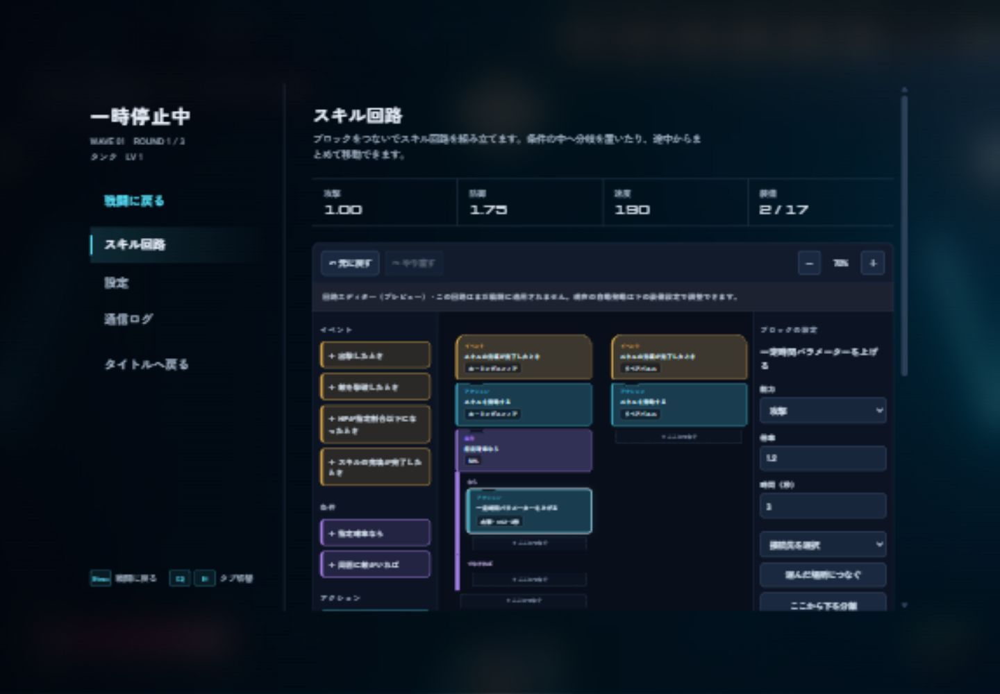

# ブロック型スキル回路エディター（ステップ2）

出撃後、Escメニューの「スキル回路」で開きます。所持中の充填型スキルから初期スタックを表示します。既存の自動発動は引き続き動き、下の「現在の戦闘装備・強化ノード」で今までと同じ装着操作ができます。



## できること

- イベント、条件、アクションをパレットからドラッグ、クリック、またはEnterで追加。
- ブロック左上を「ここにつなぐ」の左上へ近づけると、24 CSS px以内の空きポートが発光。離すと結合。
- スタックの先頭をドラッグすると全体移動。途中からドラッグすると、その下の分岐と後続もまとめて分離。
- 選択ブロックの設定欄から確率、HP割合、半径、スキル、能力、倍率、秒数を変更。
- 条件の「なら」「でなければ」へそれぞれスタックを接続。
- 設定欄の接続先選択で、ドラッグせず接続。「ここから下を分離」と「このブロックだけ取り外す」を使い分け。
- 元に戻す・やり直す（最大100操作）、Ctrl/Cmd+Z、Ctrl/Cmd+Shift+Z、Ctrl/Cmd+Y。
- 50〜200%のズーム、ワークスペースの縦横スクロール。
- スタック削除は子孫を含む個数を表示して2回目の操作で確定。Undoで復元。

ドラッグ中のEsc、領域外へのドロップ、pointercancel、pointer capture喪失、ウィンドウのフォーカス喪失はキャンセルします。確定前はグラフを書き換えないため、元の構成が残ります。Escでドラッグを取り消した後、もう一度Escを押すと戦闘に戻れます。

## 現段階の範囲

このブロック回路は編集プレビューです。戦闘適用はステップ3、JSON保存・ロードはステップ4で実装します。画面にもこの状態を表示しています。戦闘に戻る・タブを切り替える操作では編集内容を維持しますが、再出撃・ページ再読み込みで初期化されます。

入力は最大256ブロック、深さ32。循環、同一ノードの共有、イベントへの入力、占有済みポートの上書きは拒否します。初期版は空きポートへの接続に対応し、既存リンクへの割り込み挿入は行いません。未接続スタックは設定欄で警告します。未所持のスキルもテンプレートとして選択できますが、未所持であることを表示します。

## ファイルと検証

| ファイル | 責務 |
| --- | --- |
| `circuit-model.js` | ブロック定義、ID参照のグラフ、検証、変更の原子性、Undo/Redo |
| `circuit-editor.js` | パレット、分岐表示、Pointer Events、スナップ、設定欄、キーボード操作 |
| `circuit.css` | パズル形のブロック、配置、ズーム、狭い画面への対応 |
| `game.js` / `index.html` | 一時停止メニューへの組み込み、再出撃時のリセット、入力とフォーカス管理 |
| `tools/verify_circuit.cjs` | グループ分離、単体分離、分岐保持、循環・共有拒否、履歴・上限の検証 |

```bash
node tools/check.mjs
node tools/verify_circuit.cjs
node tools/verify_combat.cjs
```

ブラウザではパレットからのスナップ、分岐接続、パラメーター変更、分離とUndo、ズーム、狭い画面、従来の装備UI、一時停止からの復帰を確認してください。

実装時にはローカルブラウザで1440×1000と390×844を確認しました。スナップ、条件内への接続、数値変更、グループ移動、分離とUndo、領域外ドロップのキャンセル、従来の装備選択、戦闘への復帰後も回路を保持することを確認しています。タッチ実機での確認は未実施です。
